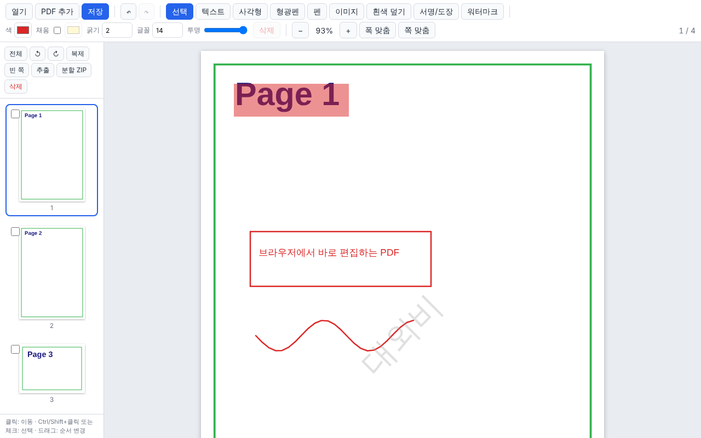

# PDF 편집기

> 소속: [Gridex-Workware](https://github.com/Gridex-Workware) · 저장소: [Gridex-Workware/Pdf](https://github.com/Gridex-Workware/Pdf) · 공개


[](https://github.com/Gridex-Workware/Pdf/actions/workflows/ci.yml)
[](https://gridex-workware.github.io/Pdf/)

브라우저에서만 동작하는 PDF 편집기입니다. 설치나 회원가입 없이 PDF를 열어 편집, 병합, 추출, 분할하고 워터마크와 서명을 넣을 수 있습니다.
파일은 서버로 전송되지 않고 모든 처리가 내 컴퓨터의 브라우저 안에서 이루어집니다.

**바로 사용하기: https://gridex-workware.github.io/Pdf/**



## 기능

| 구분 | 기능 |
| --- | --- |
| 파일 | PDF 열기, 다른 PDF 추가(병합), 끌어다 놓기, 저장(다운로드) |
| 페이지 | 회전, 삭제, 복제, 순서 변경(썸네일 드래그), 빈 페이지 추가, 선택/범위 추출, 페이지별 분할 ZIP |
| 주석 | 텍스트(한글 지원), 사각형(선/채움), 형광펜, 자유 곡선(펜), 이미지 삽입, 흰색 덮기 |
| 서명/도장 | 그리기·텍스트·이미지로 만든 서명/도장을 브라우저에 저장해 두고 반복 사용 |
| 워터마크 | 글자 또는 이미지 워터마크를 전체/선택 페이지 중앙에 하나 또는 타일로 추가 |
| 편집 | 선택·이동·크기 조절, 색/굵기/글꼴 크기/불투명도 변경, 실행 취소/다시 실행 |
| 보기 | 확대/축소, 폭 맞춤, 쪽 맞춤, 연속 스크롤, 썸네일 탐색 |

주석은 저장할 때 페이지 콘텐츠로 구워(burn-in) 들어가므로 어떤 PDF 뷰어에서도 똑같이 보입니다.

## 사용법

| 하고 싶은 일 | 방법 |
| --- | --- |
| PDF 열기 | **열기** 버튼, `Ctrl+O`, 또는 파일을 화면에 끌어다 놓기 |
| 여러 PDF 합치기 | **PDF 추가**로 파일을 더 불러온 뒤 왼쪽 썸네일을 드래그해 순서 조정, **저장** |
| 일부 페이지만 뽑기 | 썸네일 체크박스로 고르고 **추출**. 고르지 않으면 `2-3,7` 같은 범위를 입력 |
| 한 쪽씩 나누기 | **분할 ZIP**. 선택한 페이지(없으면 전체)를 한 쪽짜리 PDF로 나눠 ZIP으로 저장 |
| 페이지 회전·삭제 | 썸네일을 고르고 사이드바의 회전/삭제 버튼. 고르지 않으면 현재 페이지에 적용 |
| 글자 넣기 | **텍스트** 도구로 원하는 위치 클릭 후 입력, `Ctrl+Enter`로 확정 |
| 워터마크 | **워터마크**에서 문구·크기·각도·불투명도·타일 여부를 정하고 추가 |
| 서명 | **서명/도장**에서 그리거나 이름을 입력해 저장, 목록에서 골라 페이지 클릭 |
| 수정·삭제 | **선택** 도구로 주석을 클릭해 이동, 모서리 핸들로 크기 조절, `Delete`로 삭제 |

### 단축키

| 키 | 동작 |
| --- | --- |
| `V` `T` `R` `H` `P` `I` `W` | 선택 / 텍스트 / 사각형 / 형광펜 / 펜 / 이미지 / 흰색 덮기 도구 |
| `S` | 서명/도장 패널 |
| `Delete`, `Backspace` | 선택한 주석 삭제 |
| `Esc` | 선택 해제, 선택 도구로 복귀 |
| `Ctrl+Z`, `Ctrl+Y` (`Ctrl+Shift+Z`) | 실행 취소 / 다시 실행 |
| `Ctrl+O`, `Ctrl+S` | 열기 / 저장 |
| 텍스트 편집 중 `Ctrl+Enter` 또는 `Esc` | 편집 확정 |

## 개인정보와 보안

- 열어 본 PDF와 편집 내용은 브라우저 메모리에만 있고 어디로도 전송되지 않습니다. 탭을 닫으면 사라집니다.
- 브라우저에 남는 것은 저장해 둔 서명/도장 이미지뿐입니다(localStorage). 서명/도장 패널에서 언제든 지울 수 있습니다.
- **흰색 덮기는 보이지 않게 가릴 뿐 원래 내용을 지우지 않습니다.** 가린 글자는 PDF 안에 그대로 남아 있어 복사나 텍스트 추출로 읽힐 수 있습니다. 민감 정보를 완전히 지워야 한다면 전용 교정(redaction) 도구를 쓰세요.

## 지원 브라우저

최신 Chrome, Edge, Firefox, Safari에서 동작합니다. 휴대폰에서도 열고, 저장하고, 페이지를 다룰 수 있지만 그리기 도구는 데스크톱이 편합니다.

## 개발

```bash
npm install
npm run dev        # 개발 서버 (http://localhost:5173)
npm run build      # 타입 검사 + 프로덕션 빌드 → dist/
npm run preview    # 빌드 결과 미리보기
npm test           # 단위 테스트 (vitest)
npm run build && npm run e2e   # Playwright E2E (빌드 결과를 preview 서버로 띄워 검사)
```

Node.js 22 이상이 필요합니다.
처음 E2E를 돌릴 때는 `npx playwright install chromium`으로 브라우저를 받아야 합니다.
이미 설치된 Chromium을 쓰려면 `PLAYWRIGHT_CHROMIUM_PATH=/path/to/chrome`을 지정합니다.

### 기술 스택

- 렌더링: [pdf.js](https://mozilla.github.io/pdf.js/) (폴리필이 포함된 legacy 빌드)
- 편집/저장: [pdf-lib](https://pdf-lib.js.org/) + [@pdf-lib/fontkit](https://github.com/Hopding/fontkit)
- ZIP: [fflate](https://github.com/101arrowz/fflate)
- 빌드/테스트: Vite, TypeScript, Vitest, Playwright (UI 프레임워크 없음)

### CI / 배포

`.github/workflows/ci.yml`이 모든 푸시에서 타입 검사 → 단위 테스트 → 빌드 → E2E를 실행합니다.
기본 브랜치에서 전부 통과하면 빌드 결과를 `gh-pages` 브랜치로 푸시해 GitHub Pages에 배포합니다
(Settings → Pages → Source: Deploy from a branch, `gh-pages` / root).

`dist/`는 정적 파일이므로 다른 정적 호스팅에 올려도 됩니다. `base: "./"`로 빌드되어 하위 경로에 배포해도 동작합니다.

### 구조

```
src/
  core/
    model.ts            데이터 모델(페이지 참조, 주석), 색/회전 유틸
    document.ts         EditorDocument: 소스 PDF 관리, 페이지/주석 조작, 실행 취소 이력
    pageops.ts          페이지 배열 순수 조작 함수 + 범위 문자열 파서
    geometry.ts         주석 경계 상자, 히트 테스트, 이동/정규화
    transform.ts        pdf.js와 같은 규칙의 뷰포트 행렬(회전/배율)
    export.ts           pdf-lib로 PDF 생성(페이지 복사, 회전, 주석 굽기). 순수 데이터만 받는다
    export.worker.ts    위 내보내기를 Web Worker에서 실행
    export-client.ts    워커 호출, 메인 스레드 폴백, ZIP 분할, 다운로드
    watermark.ts        글자/이미지 워터마크 주석 생성(중앙 정렬, 타일)
    fonts.ts            한글 폰트 로딩, 유니코드 필요 여부 판단
    fontkit-patched.ts  fontkit TrueType 서브셋 버그 우회
    pdfjs.ts            pdf.js 지연 로드와 워커 설정
  ui/
    app.ts              툴바, 속성 패널, 파일 입출력, 단축키
    viewer.ts           페이지 렌더링, 도구 상호작용, 인라인 텍스트 편집
    sidebar.ts          썸네일 목록, 선택, 드래그 순서 변경
    overlay.ts          주석 캔버스 렌더링
    dialog.ts           모달 대화상자 도우미
    stamps.ts           서명/도장 패널(localStorage 보관)
    watermark-dialog.ts 워터마크 대화상자
    toast.ts            알림
e2e/                    Playwright E2E 테스트
test/                   Vitest 단위 테스트
public/fonts/           나눔고딕(OFL) — 한글 텍스트 임베딩용
docs/                   README 이미지
```

### 성능

- pdf.js(약 490KB)는 처음 PDF를 열 때, pdf-lib와 fontkit(약 1.1MB)은 처음 저장할 때만 내려받습니다. 첫 화면 번들은 약 60KB입니다.
- 저장과 ZIP 분할은 Web Worker에서 실행돼 큰 문서를 처리하는 동안에도 화면이 멈추지 않습니다. 워커를 만들 수 없는 환경에서는 메인 스레드로 대체합니다.
- 페이지는 화면에 가까워질 때만 렌더링하고, 같은 캔버스의 렌더링은 직렬화합니다.

### 좌표계

주석은 PDF 콘텐츠 좌표계(pt, 원점 좌하단)로 저장합니다. 화면 표시와 입력 변환은 pdf.js 뷰포트 행렬을 그대로 사용하므로
페이지가 회전돼도 좌표가 어긋나지 않습니다. 텍스트와 이미지는 만들 당시의 표시 회전을 `rotate`로 기억해,
회전된 페이지에서도 화면 기준으로 똑바로 보이도록 저장됩니다.

### 한글 텍스트

pdf-lib의 기본 글꼴(Helvetica)은 한글을 표현할 수 없어서, 한글이 포함된 텍스트가 있으면 `public/fonts/NanumGothic-Regular.ttf`를
서브셋으로 임베딩합니다. `@pdf-lib/fontkit`의 TrueType 서브셋에는 글리프 길이가 홀수일 때 loca 테이블이 어긋나
일부 글자가 사라지는 버그가 있어 `fontkit-patched.ts`에서 글리프를 4바이트로 패딩해 우회합니다.

## 알려진 제한

- 기존 PDF의 원문 텍스트를 직접 고치거나 지우지는 못합니다. 주석을 덧씌우는 방식입니다.
- 흰색 덮기는 시각적으로만 가립니다. 위 [개인정보와 보안](#개인정보와-보안)을 참고하세요.
- 암호화된 PDF는 열 수 있는 경우에도 저장할 때 암호가 제거됩니다.
- 폼 필드와 기존 주석은 페이지와 함께 복사되지만 편집할 수는 없습니다.
- 저장한 PDF의 주석은 다시 열었을 때 페이지 내용이 되므로 따로 선택해 고칠 수 없습니다.

## 서드파티 라이선스

| 구성 요소 | 라이선스 |
| --- | --- |
| [pdf.js](https://github.com/mozilla/pdf.js) | Apache-2.0 |
| [pdf-lib](https://github.com/Hopding/pdf-lib) | MIT |
| [@pdf-lib/fontkit](https://github.com/Hopding/fontkit) | MIT |
| [fflate](https://github.com/101arrowz/fflate) | MIT |
| [나눔고딕](https://hangeul.naver.com/font) | SIL Open Font License 1.1 (`public/fonts/OFL.txt`) |
